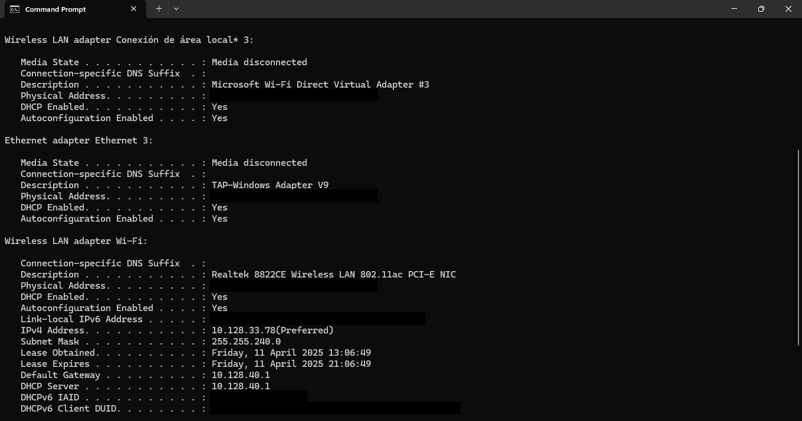

# IT Support and Networking Fundamentals

*PC troubleshooting, network concepts, virtualisation and cloud security: a scenario-based write-up*

**Type:** Coursework, Computer Network and Security (2025). Individual work.  
**Focus:** Hardware troubleshooting, BIOS/UEFI, networking fundamentals, virtualisation, cloud security, IT support practice  
**Concepts and tools:** Structured troubleshooting methodology, OSI model, ARP, switching, ipconfig, hypervisors  

## Overview

This write-up works through a set of IT support scenarios: diagnosing a new PC that powers on but shows no display, configuring BIOS/UEFI settings for creative workloads, explaining core networking concepts (MAC addresses, collision domains and switch types), evaluating virtualisation and its cloud security risks, troubleshooting intermittent network connectivity, and recommending printers for a growing business.

The scenarios are hypothetical. The troubleshooting sections describe the method I would follow and the reasoning behind each step, not repairs carried out for a real client.

## Hardware troubleshooting

### New PC powers on but shows no display

A user who needs a high-performance desktop for graphic and video design has a newly built system. On first boot the front panel LEDs light up and the fans spin, but the monitor receives no signal and the motherboard gives no beep codes. The structure below follows the standard troubleshooting methodology used in CompTIA A+ study material: identify, theorise, test, plan and document.

#### Identify the problem

The first step is to gather information, find out what has changed, back up data where relevant and ask about any environmental or infrastructure changes.

This is the system's first boot, so the cause most likely lies in the hardware installation or configuration. No software has been installed or updated, so software incompatibility can be ruled out. There are no reports of power spikes or environmental problems, and the environment is clean and properly powered. The only changes made to the system were during assembly, so the CPU, RAM and GPU need to be checked first to confirm they are seated and powered correctly.

Useful extra information to gather before changing anything:

- Whether the motherboard has diagnostic LEDs or a debug code display, since some models show visual hardware fault information.
- Whether the power supply delivers the correct voltage and every required connector is firmly seated on the motherboard and GPU.
- Documented cases of no-display problems on new builds, which can suggest common causes.

#### Establish a theory of probable cause

Start with the obvious and work outwards. The likely suspects, in order:

- **GPU seating or power:** the card may not be fully seated in the PCIe slot or may not be receiving power. If the build has no integrated graphics, the monitor must be plugged into the GPU, not the motherboard, or nothing will display.
- **RAM:** modules that are incompatible, not fully seated or in the wrong slots often prevent a system from posting, with a black screen and no beep codes. Testing one stick in different slots and checking the motherboard's Qualified Vendor List (QVL) helps rule this out.
- **CPU:** the processor may be seated incorrectly, or the CPU power connector (4-pin or 8-pin EPS) may not be connected. Bent pins and uneven cooler mounting pressure are the things to check. If the board has debug LEDs or beep codes and none trigger, the CPU may not be detected.
- **Motherboard shorts:** a standoff in the wrong place can short the board and stop it posting. Every standoff should sit under a screw hole, with none under bare areas of the board.
- **Power supply:** a PSU may deliver enough power to spin fans and light LEDs but not enough to boot. Causes include low wattage, a dead unit or incorrect cable connections. Check the 24-pin and other power connectors, and cross-test with a known-good PSU if one is available.

#### Test the theory

1. **GPU:** power the system off, reseat the card firmly in the PCIe slot and confirm the 6-pin or 8-pin power connectors are fully plugged in. Connect the monitor to the GPU's port. If there is still no signal, try another PCIe slot or test the card in a known-good machine.
2. **RAM:** remove all sticks and fit one in the recommended slot (usually the second slot from the CPU). Test that stick in every slot, then repeat with each of the other sticks. If the system boots with a particular stick or slot, the fault is a bad module or a burnt-out DIMM slot.
3. **CPU:** inspect the socket and processor for bent pins (the pins are on the socket for Intel LGA platforms and on the processor for older AMD PGA chips), check that the cooler is mounted evenly and confirm the 8-pin (or 4+4 pin) CPU power connector is fully inserted. Debug LEDs or a POST test card, if available, show whether the CPU is recognised.
4. **Bench test:** if the GPU, RAM and CPU all look fine, remove the motherboard from the case and place it on a non-conductive surface with only the CPU, one stick of RAM, the GPU and the PSU connected. If it boots outside the case, the problem lies in the case wiring or mounting.
5. **If nothing works:** the theory is not confirmed and a core component, most likely the motherboard or PSU, may be faulty. Form a new theory or escalate: swap in known-good components, contact the manufacturer for RMA support, or take the system to a professional repair centre.

#### Plan of action and implementation

Reset the major components methodically: remove and reinstall the GPU, RAM and CPU, checking each for bent pins, cracked contacts or dust in connectors. Reconnect the 24-pin ATX, 8-pin CPU and GPU power cables, making sure each is firmly seated. Reassemble and test in an open-air setup to rule out case grounding problems.

Then test the GPU in a second working system or replace it with a known-good card, and test the RAM the same way. If both work, move on to the PSU, using a PSU tester or substitution. If every other component proves fine, the motherboard is the likely point of failure and may need replacement or RMA processing.

#### Document the findings

Good documentation lets the next technician pick up the case without repeating work. A record for this scenario would look like this:

- **Reported issue:** new high-performance desktop for graphic design and video editing showed no display on first power-up. LEDs and fans worked, with no beep codes or error messages.
- **Initial inspection:** no obvious physical damage. Possible causes identified from common failure points in new builds: GPU, RAM or CPU seating, power supply or motherboard fault.
- **Actions:** reseat the GPU, confirm PCIe power and the correct monitor output; test RAM stick by stick in each slot; reinstall the CPU after checking for bent pins; bench-test outside the case with minimal components; try a known-good GPU; recheck all power connections.
- **Outcome:** record which step restored the display, the faulty part if one was found, and any parts replaced or returned under RMA. (Left open here, because this is a scenario.)

### Wrong date and time, and BIOS/UEFI settings that do not stay saved

Suppose the system now boots, but it shows the wrong date and time and forgets its BIOS/UEFI settings after every restart. The probable cause is a dead or incorrectly installed CMOS battery.

The CMOS battery, usually a CR2032 coin cell, keeps the real-time clock running and preserves BIOS settings while the computer is off. When it fails or is missing, the system loses its configuration at every shutdown or power removal. Symptoms include the clock resetting to a default date (often years back), changed boot order, and BIOS warnings such as "CMOS checksum error" or "Date and Time Not Set".

To fix it:

1. Shut the system down completely and unplug it from the wall.
2. Open the case and find the battery, most often near the PCIe slots or the chipset heatsink.
3. Remove it carefully and check for corrosion, dust or looseness.
4. If it looks damaged or old, replace it with a new CR2032, which is inexpensive and sold at electronics and grocery stores.
5. Boot into BIOS/UEFI, set the correct date and time and reapply any custom settings.

### Tuning BIOS/UEFI for graphic design and video editing

By default, memory runs at the standard JEDEC speed, typically 2133 MHz, even when the kit is rated for 3000 MHz, 3200 MHz or higher. Enabling the memory profile in BIOS/UEFI (called DOCP on many AMD boards and XMP on Intel) lets the RAM run at its rated speed. That improves responsiveness, multitasking and performance in memory-demanding work such as video editing, 3D rendering and gaming.

Before enabling it, confirm that both the motherboard and the CPU officially support the RAM's rated speed. Most modern boards do, but running memory beyond supported levels without sufficient voltage or cooling can cause instability or boot failure.

The boot order should also be set so the drive holding the operating system comes first, so the machine starts reliably. With the memory profile and boot order configured correctly, the hardware runs at its advertised capability without boot problems, which is how a high-performance build earns its cost.

## Networking fundamentals

### MAC addresses: what they are and how they work

A MAC address is a hardware identifier built into a network interface card. Its job is to make sure data on a local network reaches the right physical device. It works at the Data Link layer (Layer 2) of the OSI model, where switches and other network equipment use it to decide where to forward data frames so they are delivered accurately and efficiently.

A MAC address is 48 bits long and written in hexadecimal. The first 24 bits are assigned to manufacturers by the IEEE, and the manufacturer assigns the remaining 24 bits to each card it produces, so no two devices share the same address.

On a local area network, a device that wants to send data uses ARP to find the MAC address that matches the target's IP address. Once it has learned it, frames are sent directly to that MAC address. LAN switches learn which device is connected to which port and forward frames only to the correct destination, which keeps communication efficient and reduces network traffic.

### Finding a MAC address in Windows

Open Command Prompt and run `ipconfig /all` (with a space between `ipconfig` and `/all`). This lists detailed information for every network interface. Find the active adapter and read its "Physical Address", which is the MAC address.

*Output of ipconfig /all. Physical addresses and other device identifiers are redacted.*

### Collision domains: hubs versus switches

A collision domain is a part of a network where data packets can collide while travelling over a shared medium, especially in Ethernet. A collision happens when two or more devices transmit at the same time on the same segment and their signals interfere. The devices must then wait and retransmit, which slows the network. Collision domains matter most in older half-duplex Ethernet.

A hub is a simple Layer 1 (Physical layer) device that repeats incoming signals to all other ports. Every device on a hub therefore shares one collision domain and the same bandwidth, with no traffic separation, which makes collisions more likely.

A switch works at Layer 2 and uses MAC addresses to send data only to the destination port. Each switch port is its own collision domain, so a switch reduces interference and makes communication more dependable.

### Managed versus unmanaged switches

Unmanaged switches need no configuration. They switch data between devices automatically using MAC addresses, which suits small, simple networks that only need basic connectivity and no monitoring.

Managed switches add features such as VLAN support and remote configuration and management through a web interface or network management software. They are typically used in enterprise environments, data centres and universities, or wherever advanced traffic management and troubleshooting are needed.

## Virtualisation and cloud

### Virtualisation and how it relates to cloud computing

Virtualisation creates virtual copies of physical resources, such as servers, storage or operating systems. It lets several virtual machines (VMs) run on one physical machine, each behaving like a separate, independent system. This improves resource use, flexibility and scalability in IT infrastructure. Cloud computing builds on virtualisation by using those virtualised resources to deliver services.

### Choosing a virtualisation platform for variable workloads

For a company whose workloads rise and fall, a hypervisor-based platform such as VMware vSphere, Microsoft Hyper-V or Proxmox VE is a sound choice, because it runs many virtual servers on fewer physical servers. Scaling becomes easy: when more processing power is needed, new VMs are started instead of buying new hardware, and when demand drops, VMs are shut down, which saves power and hardware costs.

### Cloud and virtual environment security risks

- **Data breaches:** data that is not locked down securely can be exposed to attackers. Encrypting data at rest and in transit, and using strong access controls, reduces the risk.
- **Insecure APIs:** attackers can exploit weaknesses in poorly secured cloud service APIs. Token-based authentication is one way to defend against this.
- **Lack of control and visibility:** in virtual and cloud systems it is easy to lose track of what is running and where. Regular log reviews and centralised management tools improve oversight and monitoring.

## Network support

### Troubleshooting intermittent network connectivity

An office user's workstation intermittently loses its network connection, which disrupts access to files and VoIP calls. The approach below goes from the cheapest, most likely causes to the least likely.

#### Likely causes

- **Faulty cable or wall port:** a damaged or loosely connected Ethernet cable, or a loose or faulty wall port, can interrupt the signal and cause delays and disconnections.
- **Switch port problems:** a malfunctioning switch port can cause random drops. Moving the workstation to another port, or replacing the faulty switch, fixes this.
- **Power or interference:** unstable power to the switch or router, or electrical interference, can cause periodic drops.
- **Network card or drivers:** a failing NIC or outdated drivers can make performance fluctuate.

#### Diagnostic steps

1. **Cable and wall port:** inspect the cable from the workstation to the wall port for fraying or bends. If it looks damaged, replace it with a known-good cable and retest. Also try a different wall port to see whether the fault is specific to one port.
2. **Patch panel:** check that cables at the central patch panel are firmly seated, and re-seat any that look loose or mis-seated. A loose patch panel connection produces intermittent faults.
3. **Congestion:** use network monitoring software to look for excessive traffic, especially if other users are moving large files or running bandwidth-heavy applications such as VoIP. If congestion is found, add bandwidth or use Quality of Service (QoS) settings to prioritise critical traffic.
4. **Power and interference:** confirm the switch and router have a reliable power source, use surge protectors or proper grounding where power fluctuates, and move network equipment away from nearby electrical devices that cause interference.
5. **The workstation itself:** once the hardware side is clear, check whether a firewall or antivirus program is interfering with the connection. Inspect the IP, DNS and gateway settings and use `ipconfig` and network diagnostics to check for adapter problems.

#### Recommended fix

Replace any damaged cables, repair faulty wall ports or patch panel connections, and move the workstation to a stable switch port with the correct speed and duplex settings. These are quick, inexpensive fixes that should restore stable access to files and VoIP with minimal disruption.

## Peripherals

### Inkjet versus laser printers for a growing business

Inkjet and laser printers suit different needs. Inkjets are good at high-quality colour photographs and cost less to buy, which makes them best for photos or graphics in small quantities.

Laser printers are built for speed and efficiency. They handle heavy-volume printing better, with a lower cost per page and longer-lasting toner cartridges. They cost more upfront but need less frequent maintenance and last longer under heavy use. Colour laser printers are costlier still, but remain more economical over time for heavy use.

For a growing company, laser printers are the better choice: they cope with heavier workloads, pay off in the long run and give the speed and dependability a busy office needs. Inkjets can still serve occasional graphics work, but lasers scale more sensibly as the business grows.

## Skills demonstrated

- Applying a structured troubleshooting methodology to hardware and network faults.
- Diagnosing no-display and no-POST faults on new PC builds across CPU, RAM, GPU, PSU and motherboard.
- BIOS/UEFI configuration: CMOS battery faults, memory profiles and boot order.
- Networking concepts: MAC addressing, ARP, collision domains, and managed versus unmanaged switches.
- Virtualisation, hypervisor selection and cloud security risks.
- Writing clear technical documentation and recommendations for non-specialist readers.
